# Tabula: what exists right now

> **Update after Phase 2 (2026-10-10):** the app now has real screens: onboarding, Today, Timetable (grid / week / day / tiles), editors, settings, in 12 languages. Current screenshots are in [`screenshots/phase2/`](screenshots/phase2/). The gate report is `docs/gates/PHASE-2.md`. The sections below describe the state after Phase 1 and are kept for history.

# Phase 1 state (historical)

Date: 2026-10-08 · Code: `main` @ `22af18c` · Screenshots: iOS 27 Simulator (iPhone Pro Max) from CI run [37697929357](https://github.com/simon01920/tabula-app-ios/actions/runs/37697929357)

## The honest summary
- **There is no user-facing app yet.** Phase 1 built the *engine*: the data model, timetable logic, reminders, sharing, sync and storage. Screens (onboarding, the timetable views, editors) are **Phase 2**.
- **What runs on an iPhone today is the Phase 0 *probe app*:** a developer screen that proves the toolchain, frameworks and languages work. It is deliberately plain: a system `List` with status rows. It is not the design.
- **What the engine can already do** is shown in [`screenshots/current/engine-demo.html`](screenshots/current/engine-demo.html). That page is real Phase 1 code running on sample data, rendered for inspection. It is **not** the app's UI.

## 1. The app as it runs today (probe screens)
Each screen exists in light, dark and the largest accessibility text size (AX-XXXL).

| Screen | Light | Dark | Largest text |
|---|---|---|---|
| Platform | 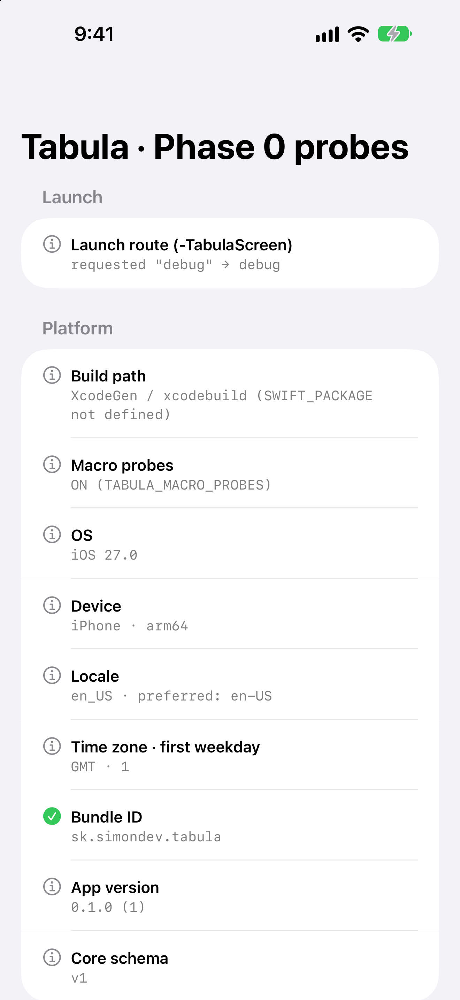 | 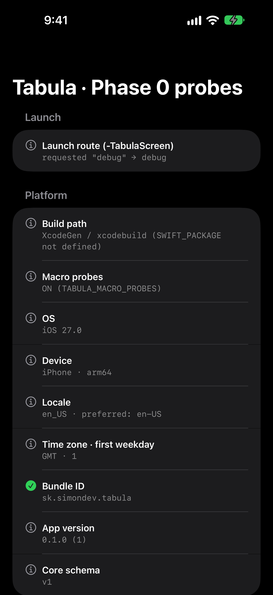 | 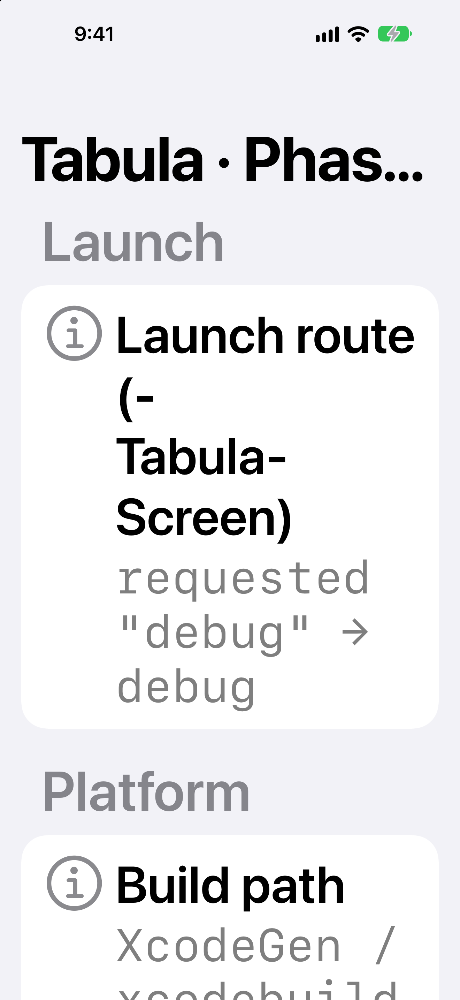 |
| Macros & App Intents | 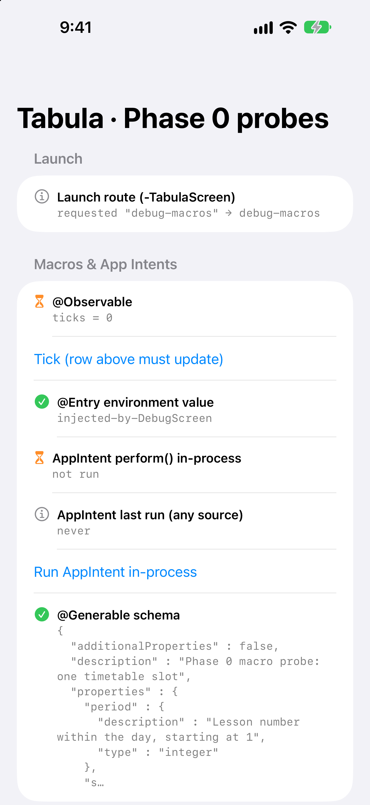 | 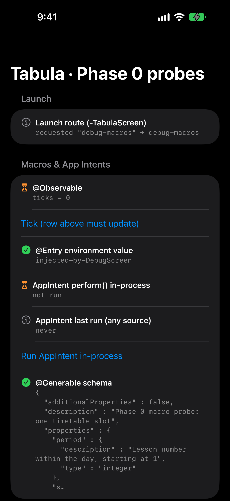 | 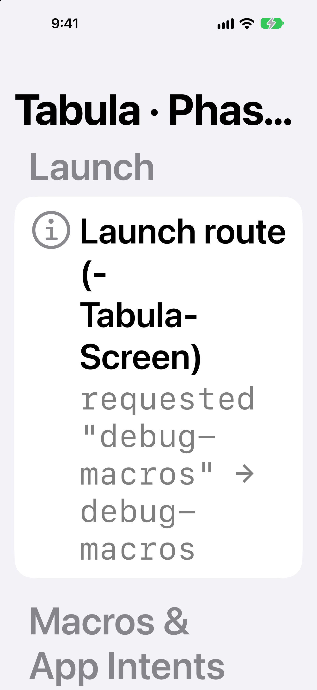 |
| Localization | 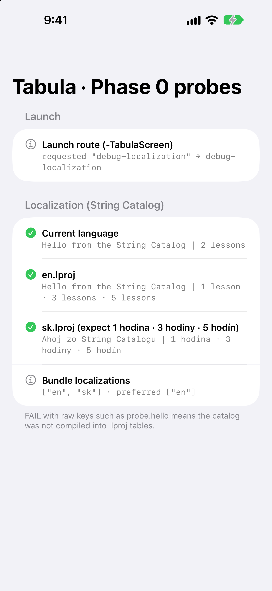 | 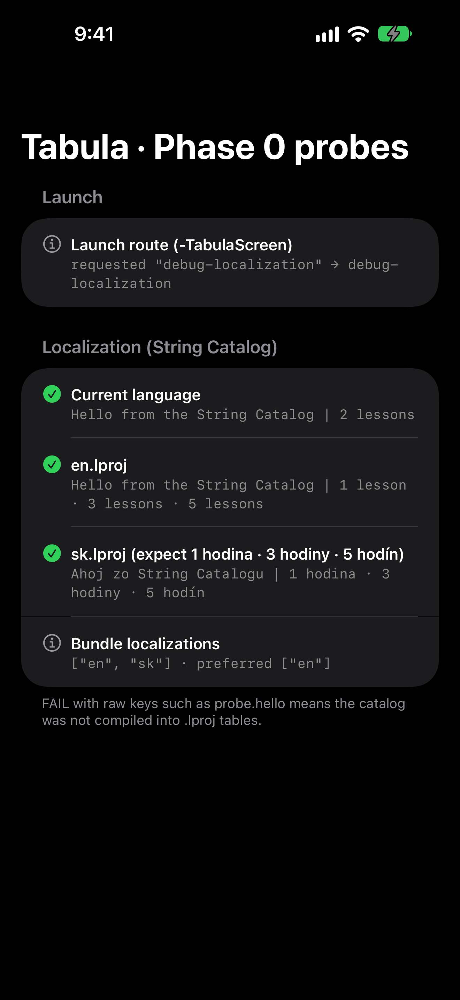 | 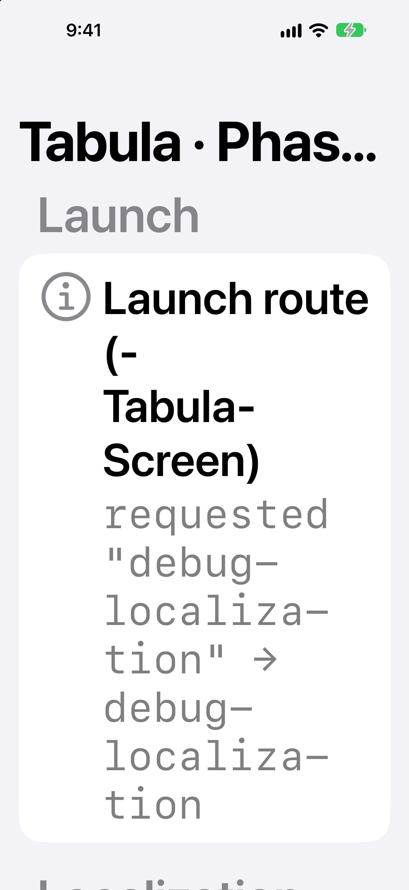 |
| AI-import probes (OCR + on-device model) | 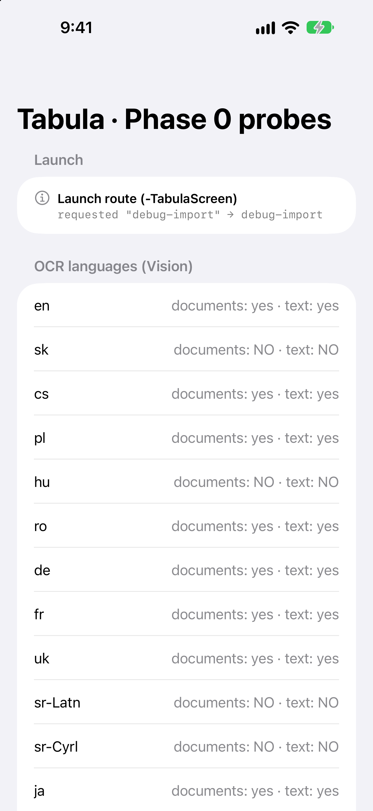 | 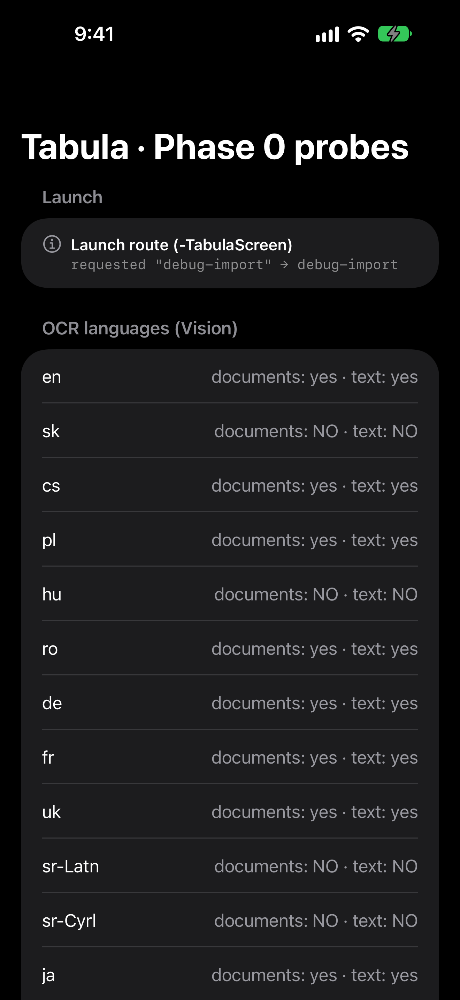 | 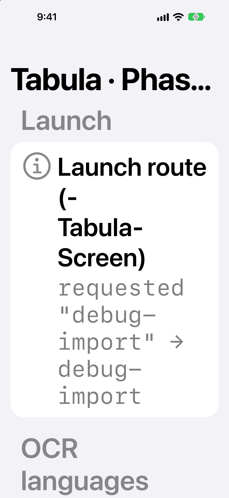 |
| Alarms & notifications | 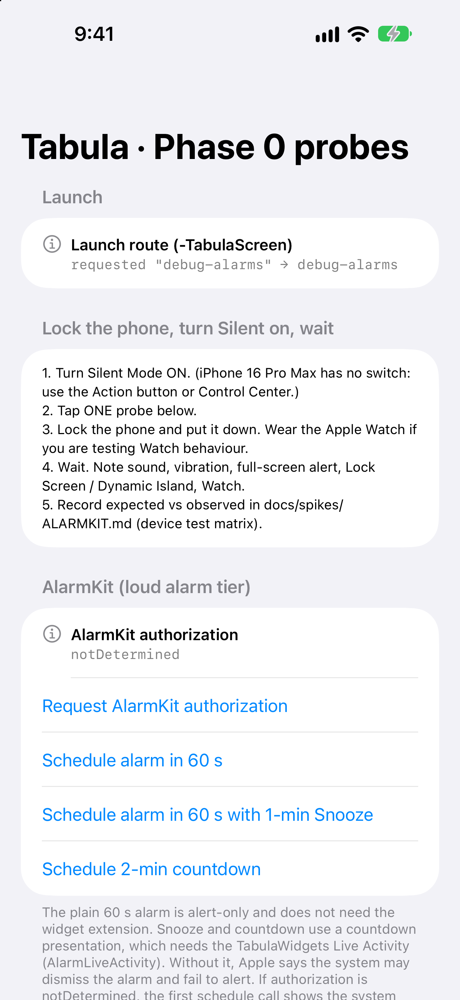 | 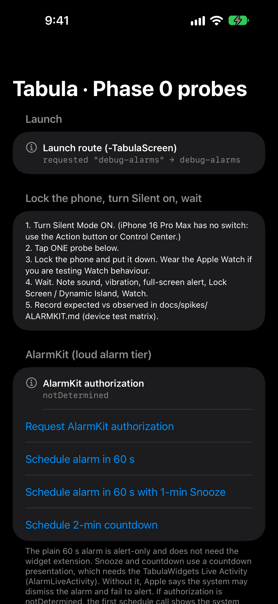 | 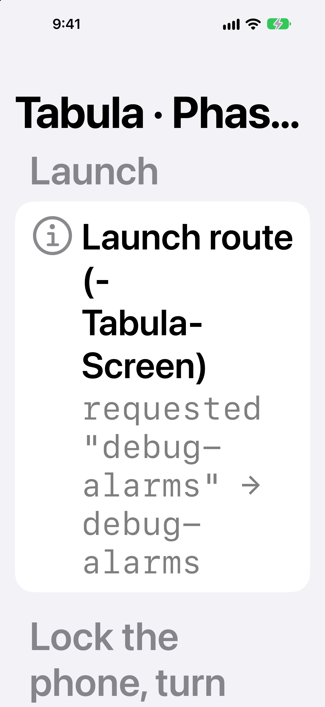 |

### What the screens prove (look & feel notes)
- **Look:** standard iOS 27 grouped list with Liquid Glass-era rounded cards. The system font is used everywhere, and monospaced values show machine output. Dark mode is automatic and correct.
- **Platform:** iOS 27.0, bundle `sk.simondev.tabula`, app 0.1.0, schema v1, built through the Xcode (CI) path with macro probes on.
- **Macros:** `@Entry` ✓ and `@Generable` ✓ expand and run. The `@Observable` row waits for a tap, which a screenshot can't give it.
- **Localization:** the String Catalog works in English and Slovak, including **Slovak plurals** ("1 hodina · 3 hodiny · 5 hodín").
- **AI-import probe, an important measurement:** Apple's on-device text recognition (Vision OCR) reports **no Slovak, Hungarian or Serbian** on iOS 27. Czech, Polish, Romanian, Ukrainian, German, French and Japanese are supported. This reshapes the Phase 9 import plan (RISKS #7).
- **Alarms:** the AlarmKit test buttons are present. Real alarm behaviour (silent mode, lock screen, Watch) needs the physical iPhone.
- **Largest text:** the layout reflows rather than clipping. The long title truncates ("Tabula · Phas…"), which is acceptable for a debug screen but a reminder that Phase 2 titles must be short or wrap.
- **Feel:** it is a developer tool. It has no navigation, no onboarding and no timetable yet. Its job is to make "does X work on iOS 27?" a screenshot rather than a guess.

## 2. What the engine already does (Phase 1)
See [`screenshots/current/engine-demo.html`](screenshots/current/engine-demo.html), regenerated with `bash scripts/engine-demo.sh` in WSL. The section below is filled in from that page.

Scenario: a Slovak gymnasium class (2.B), secondary-school profile, odd/even (A/B) weeks, "now" = Tue 13 Oct 2026 10:20, Europe/Bratislava. Everything below is computed by the real engine.

| What | Result | Capture |
|---|---|---|
| Onboarding | Secondary preset: 8 × 45-min bell schedule from 08:00, room + teacher fields on, A/B weeks; 12 subjects, 32 lessons (3 only in week A, 2 only in week B, 4 with a bring-list); validation 0 issues | 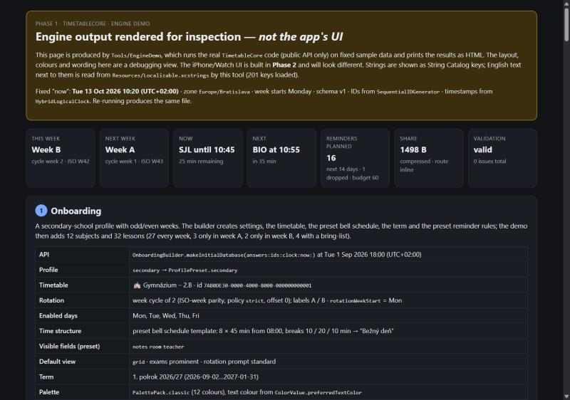 |
| Week grid | This week = **Week B** (ISO W42), next week = **Week A**. Thursday shows a short day ("Skrátené vyučovanie"), a cancelled English lesson (struck through), Maths moved to the Aula with a substitute teacher, and a double-period Informatics spanning two rows | 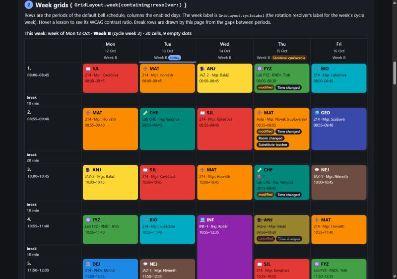 |
| Now & Next | In lesson: **SJL until 10:45 (25 min left)**, next **Biológia at 10:55** | 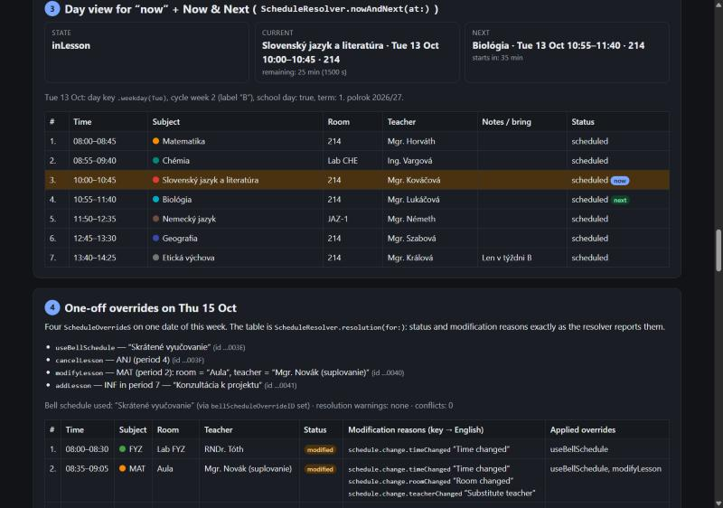 |
| Time blocks | A proportional day view, normal Tuesday next to the short Thursday | 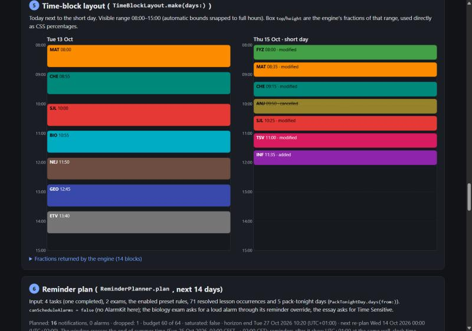 |
| Reminders (14 days) | 16 notifications planned (budget 60 of 64), 1 dropped with a reason. Homework "due tomorrow" at 17:00, follow-ups the next morning, "pack your bag" for Thursday. Time Sensitive is downgraded when the lead is too long; a loud alarm is refused without AlarmKit. Correct across the 25 Oct DST change | 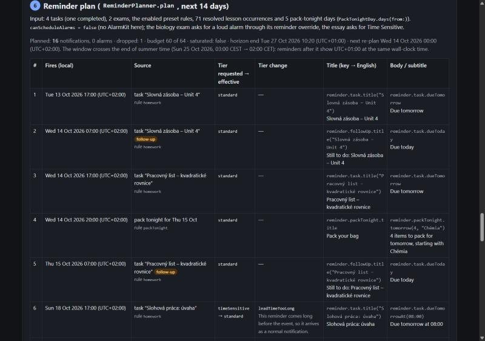 |
| Sharing | Whole timetable: 3.9 KB JSON → **1.5 KB compressed** → fits an inline link (2,029 chars) / QR; sample short code `AVQZ-TWKU` | — |

What this shows about the feel of the future app:
- **Colours:** subject colours come from the palette packs, and the text colour on each tile is chosen automatically for contrast.
- **Changes are explicit:** modified, cancelled and added lessons carry reasons that the UI will turn into badges.
- **Optional fields stay out of sight:** "notes" and "bring" appear only where they exist.

All strings are still *keys* (e.g. `reminder.task.dueTomorrow`); the English next to them comes from the String Catalog.

## 3. How to get fresh screenshots yourself
**Option A: GitHub website, no tools.**
1. Open https://github.com/simon01920/tabula-app-ios/actions
2. Choose **"UI screenshots (iOS Simulator)"**, then **Run workflow** (branch `main`). It takes about 7 minutes and uses about 10 macOS minutes from your monthly allowance (private repo).
3. Open the finished run and scroll to **Artifacts**. Download `ui-screenshots-N` (a zip of PNGs).

It also runs automatically when UI code (`App/`, `WidgetExtension/`, `Packages/TimetableUI/`, `Resources/`) changes on `main`.

**Option B: one command (PowerShell or Git Bash).**
```bash
gh run download --repo simon01920/tabula-app-ios --name ui-screenshots-3
```
(Replace `3` with the run number shown on the Actions page.)

**Option C: in your browser, interactively.** The CI run also uploads the simulator build (`TabulaApp-iphonesimulator-N`). A browser-streamed simulator service such as Appetize.io can run that `.app` so you can tap through it. That needs an account on their side, so it is not set up; ask if you want it.

**Why not on Windows directly:** Apple's iOS Simulator exists only on macOS. Every "iOS emulator" offered for Windows is either a remote Mac or a fake skin.

## 4. On your iPhone later (Phase 2+)
The WSL route is: `usbipd-win` attaches the iPhone to WSL, then `bash scripts/xtool-dev.sh` builds and installs. That needs your Apple ID login in xtool. A free Apple ID works for 7-day installs; App Groups, alarms and Time Sensitive need the paid account. Exact steps: `docs/ENVIRONMENT.md` §14. Fallback if USB passthrough is flaky: the iTunes relay in §9.
